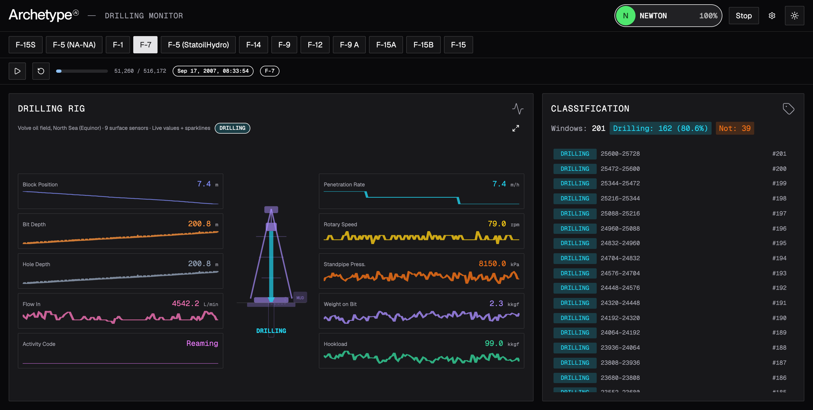

# Newton Drilling Monitor

Drilling state classification dashboard powered by [Newton](https://www.archetypeai.io/) and the [Equinor Volve Data Village](https://www.equinor.com/energy/volve-data-sharing).

Plays back real drilling sensor data from 14 wells in the Volve oil field (North Sea, 2007–2009 drilling phase) and classifies each data window as **drilling** or **not_drilling**: **Newton Omega 1.5** embeds every window through the Archetype AI **Inference API**, and a **local KNN** scores it against an n-shot reference library. Includes live evaluation against ACTC ground truth.

Moved from the [Direct Query version](https://github.com/archetypeai/archetypeai-drilling-demo) (Omega 1.4 on `/api/lens/query`). See [MIGRATION.md](MIGRATION.md) for what changed and how the two compare.

> The Volve field operated 2007–2016, but real-time drilling sensor data only covers the 2007–2009 construction phase. After 2009 the rig left and the field moved to production (different file types, no real-time WITSML streams).



## Features

- **14 wells** from the Volve North Sea oil field, sorted by class balance (wells with both drilling and not-drilling activity first)
- **Rig instrument panel** — SVG drilling rig with 10 live sensor sparklines (9 channels + ACTC ground truth)
- **Playback controls** — play, pause, reset with progress bar, human-friendly timestamps
- **Inference API classification** — each 128-sample window is embedded by Omega 1.5 in one session query and classified by a local KNN as drilling or not_drilling
- **Classification log** — scrolling list of predictions with drilling/not-drilling counts
- **N-shot library (leakage-free)** — built offline from two **held-out reference wells** (F-10, F-4) that are excluded from the well selector, so every well you can classify is genuinely unseen. Unanimous-ACTC windows from those wells are embedded into a local KNN library (`data/knn-library.json`) by `scripts/build-knn-library.js`
- **Synchronous per-window inference** — `POST /api/classify` returns the verdict for each window directly; the server keeps one Omega session open and reuses it
- **Incremental data loading** — full raw CSVs (up to 1.9M rows) loaded in 5,000-row chunks during playback
- **Auto-seek** — automatically starts playback at the section with the best drilling/not-drilling balance (scored by unanimous windows, not raw rows)

### Advanced Mode (⚙)

- **Live Evaluation** — compares predictions against ACTC ground truth (unanimous windows only), shows accuracy, F1, precision, recall, confusion matrix, and per-window pass/fail log

## Notes on the Encoder

The classifier embeds with **Omega 1.5** (`omega-embedding` on the Inference API). Every window is scaled with a fixed global scaler (`data/scaler.json`) first, so cross-window amplitude is preserved rather than erased by per-window normalization. All nine channels go to the session in one query, and the per-channel 768-d embeddings come back concatenated in channel order: the joint 6,912-d feature the KNN compares.

The library and the live query path must use the same encoder and window length: different encoders produce unrelated vectors (same shape, different values), and KNN distances across them mean nothing. If you change `OMEGA_MODEL` in `src/lib/inference-client.js` or `windowSize` in `DEFAULT_CONFIG`, rebuild the library.

### Per-well accuracy

`node scripts/eval-wells.js` scores the library on every playable well. For each well it takes up to 15 unanimous-ACTC windows per class, evenly spaced through the well (window 128, k=3), with DRILLING as the positive class. On production (Omega 1.5, 2026-11-13; about 2 minutes):

| Well | Accuracy | F1 | Eval windows |
|---|---:|---:|---:|
| F-1 | 100% | 100% | 30 |
| F-14 | 100% | 100% | 30 |
| F-9 | 100% | 100% | 30 |
| F-12 | 97% | 97% | 30 |
| F-5 (NA-NA) | 93% | 94% | 30 |
| F-5 (StatoilHydro) | 93% | 94% | 30 |
| F-7 | 93% | 93% | 30 |
| F-15S | 87% | 86% | 30 |
| F-9 A † | 83% | 85% | 24 |
| F-15B † | 71% | 83% | 17 |
| F-15 † | 50% | 67% | 20 |
| F-15A † | 41% | 56% | 29 |

Across the **8 wells with substantive both-class activity**, held-out accuracy averages **95%** (F1 95%), and these are genuinely unseen wells: the references come only from the held-out F-10 and F-4. [MIGRATION.md](MIGRATION.md) compares this with Omega 1.4 on the same windows.

† **Single-class wells** (>99% drilling: F-9 A, F-15, F-15A, F-15B) have only 2–14 not-drilling windows in the entire well, so a balanced sample over-weights that rare class and the metric is noisy/misleading — see [Single-class wells show misleading metrics](#single-class-wells-show-misleading-metrics). They're sorted to the end of the selector.

## Stack

- **SvelteKit** with Svelte 5 runes
- **Archetype AI Design System** — semantic tokens, component primitives, composite patterns
- **Archetype AI Inference API** — Omega 1.5 embeddings from one session + local KNN classification
- **Geist and Geist Mono** — open-source fonts (SIL Open Font License) in place of the design system's PP Neue Montreal
- **Tailwind v4** — styling with semantic design tokens

## Dataset

The [Equinor Volve Data Village](https://www.equinor.com/energy/volve-data-sharing) provides real-time drilling sensor data from the Volve oil field. 9 sensor channels at ~1-second resolution:

| Channel | Description | Unit |
|---------|-------------|------|
| BPOS | Block Position | m |
| DBTM | Bit Depth | m |
| FLWI | Flow In | L/min |
| HDTH | Hole Depth | m |
| HKLD | Hookload | kkgf |
| ROP | Rate of Penetration | m/h |
| RPM | Rotary Speed | rpm |
| SPPA | Standpipe Pressure | kPa |
| WOB | Weight on Bit | kkgf |

**Drilling** (ACTC 1-2) = bit on bottom, rotating, mud flowing, hole getting deeper. **Not drilling** (ACTC 3/4/8/9) = tripping, circulating, shut in, etc.

## Setup

Requires Node.js 20 or later and [Git LFS](https://git-lfs.com) (the 14 well CSVs, about 1.1 GB, are stored via LFS):

```bash
git lfs install
git clone https://github.com/archetypeai/archetypeai-drilling-demo-model-serving.git
cd archetypeai-drilling-demo-model-serving
npm install
cp .env.example .env      # then add your API key
```

`.env` holds your Archetype AI API key and the production endpoint:

```
ATAI_API_KEY=your_api_key_here
ATAI_API_ENDPOINT=https://platform.u1.archetypeai.app
```

The `.env` file wins over any `ATAI_*` variables exported in your shell (see `vite.config.js`).

`data/scaler.json` and `data/knn-library.json` are committed, so the demo runs out of the box — no build step needed for a normal run.

Rebuild the reference library only if you change the held-out reference wells, the window size, or the encoder:

```bash
node scripts/build-scaler.js        # data/scaler.json  (per-channel robust median/IQR)
node scripts/build-knn-library.js   # data/knn-library.json  (labeled Omega embeddings)
```

Both read the held-out reference wells from `src/lib/reference-wells.js`; `build-knn-library.js` reads `.env` directly. Building the library takes about 15 seconds.

To score the library on every playable well: `node scripts/eval-wells.js` (see [Per-well accuracy](#per-well-accuracy)).

## Development

```bash
npm run dev
```

Open `http://localhost:5173`, select a well, click **Start Analysis**, then press Play.

## How It Works

1. Select a well — data loads incrementally from full raw CSVs (up to 1.9M rows per well)
2. **Start Analysis** arms the analysis and classifies the first window; that first call opens the server's Omega session
3. Press **Play** — data plays back at accelerated speed, advancing the rig sparklines and playhead
4. The window **under the playhead** is POSTed to `/api/classify` (up to 3 in flight), so verdicts track what's on screen
5. The server scales the window with the global scaler, sends all nine channels to the Omega session in one query (one 768-d vector per channel comes back, in channel order), and runs a local KNN against `data/knn-library.json`
6. The verdict returns synchronously and appears as colored bands on the rig and entries in the classification log

## Architecture

```
src/
├── routes/
│   ├── +page.svelte                  # Dashboard orchestrator
│   └── api/
│       ├── classify/+server.js       # POST window → { label, votes, neighbors }
│       ├── wells/+server.js          # List wells sorted by class balance
│       ├── wells/data/+server.js     # Paginated well data chunks
│       └── wells/mixed-offset/       # Find best mixed section (auto-seek)
├── lib/
│   ├── inference-client.js           # Inference API client: Omega session, retries, Newton query
│   ├── server/newton.js              # Omega session per server + local KNN
│   ├── reference-wells.js            # Held-out reference wells (F-10, F-4) + ACTC code sets
│   ├── api/drilling.js               # Client-side fetch wrappers (classifyWindow)
│   └── components/ui/custom/
│       ├── rig-dashboard.svelte      # SVG rig + 10 sensor sparklines
│       ├── classification-log.svelte # Prediction history + stats
│       ├── accuracy-panel.svelte     # Live Evaluation (accuracy, F1, confusion matrix)
│       ├── playback-controls.svelte  # Play/pause/reset + progress
│       └── well-selector.svelte      # Well button grid
├── scripts/
│   ├── build-scaler.js               # Offline: per-channel scaler → data/scaler.json
│   ├── build-knn-library.js          # Offline: embed n-shot refs → data/knn-library.json
│   ├── eval-wells.js                 # Score the library on every playable well
│   └── windows.js                    # Window helpers shared by the scripts
├── data/                             # scaler.json + knn-library.json (both committed)
└── static/data/
    └── wells/                        # 14 full raw well CSVs (Git LFS).
                                      # F-10 + F-4 are the held-out reference pool
                                      # (build the library); the other 12 are classified.
```

## Newton API Pattern

This demo calls Omega 1.5 through the **Inference API**: the same time-series pattern as the [SWaT water-treatment demo](https://github.com/archetypeai/archetypeai-swat-demo-model-serving) and the [wind turbine demo](https://github.com/archetypeai/archetypeai-wind-turbine-demo-model-serving).

The server opens one Omega session with a 128-sample window and reuses it for every query:

```json
POST /api/inference/sessions
{ "model": "omega-embedding", "values": { "window_size": 128, "step_size": 128 } }
→ 201 { "id": "<session id>" }
```

Each query carries one window, channel first:

```json
POST /api/inference/sessions/{id}/query
{
  "model": "omega-embedding",
  "query": "",
  "events": [
    { "type": "data.numeric_array", "event_data": { "contents": [[/* BPOS: 128 values */], [/* DBTM */], "... 9 channels"] } }
  ]
}
```

The answer is one row of `9 × 768` values, the per-channel vectors in channel order:

```json
{ "response": { "success": true, "response": [[/* 6,912 values */]] } }
```

Classification is `scale → embed all 9 channels in one query → KNN against the local library`. The session is cancelled when the server stops. `src/lib/inference-client.js` handles retries, reopening an expired session and a bounded number of queries in flight.

## Classifier Config

`DEFAULT_CONFIG` in `src/lib/server/newton.js`:

```js
{ windowSize: 128, stepSize: 128, nNeighbors: 3 }   // KNN metric: euclidean
```

The window/step were tuned with [newton-streaming-optimizer](https://github.com/archetypeai/newton-streaming-optimizer) on Omega 1.4. The library is built at the same `windowSize`/`stepSize` by `scripts/build-knn-library.js`, and the session's `window_size` is the same 128.

## Known Limitations

### Accuracy varies widely by well

Held-out prod accuracy is **95% across the 8 both-class wells** (see the per-well table above), but it varies with each well's operational profile, transition frequency, and similarity to the reference wells, and the single-class wells score lower on a balanced sample. This isn't a bug — it's the inherent limitation of few-shot classification with a generic encoder.

### No "I don't know" answer

KNN always picks the nearest class, even when the input is far from any n-shot example. Wells with unusual operations (sidetracks, casing, completions) that don't resemble either the "drilling" or "not drilling" references will be force-classified into one, often incorrectly. A distance threshold or abstention mechanism would help but isn't implemented here.

### Single-class wells show misleading metrics

Four classifiable wells are effectively single-class (>98% drilling): F-9 A, F-15, F-15A, F-15B. They sort to the end of the selector. Their per-well numbers above are noisy because a balanced eval sample over-weights the 2–14 not-drilling windows that exist; in normal use (mostly drilling) they score much higher.

### Transition-heavy sections produce many skipped windows

At `window_size=128`, windows that straddle a drilling↔not-drilling transition contain mixed ACTC codes and are excluded from evaluation. Wells like F-7 with frequent state changes can have 30%+ skipped windows. The auto-seek minimizes this by starting at a section with the most *unanimous* (single-class) windows, but some skipping is inevitable.

### Leakage-free split (held-out reference wells)

The references come from two **held-out wells** — F-10 (drilling-rich) and F-4 (not-drilling-rich) — that are excluded from the well selector, so no well you can classify ever contributed a reference window. `build-scaler.js` and `build-knn-library.js` read this list from `src/lib/reference-wells.js`; only unanimous-ACTC windows become references.

> Earlier versions sampled the n-shot examples (the bundled `volve_drilling.csv` / `volve_not_drilling.csv`) from across *all* wells, which leaked reference rows into the very wells being scored and flattered accuracy on the wells that contributed most. Those files were removed; the library is now built from the held-out wells only.

### Latency

One window takes about 0.3 s on production (median of 15 queries; the first query also opens the session, about 0.7 s). The UI still classifies the window **under the playhead** rather than sequentially from the start, with up to 3 windows in flight at once (`MAX_IN_FLIGHT` in `+page.svelte`), so verdicts track what's on screen even at fast playback. The library is precomputed offline, so there's no per-session warm-up wait.

### Sessions

The server holds one Omega session while it runs, and cancels it when it stops (Ctrl-C in `npm run dev`, or SIGINT/SIGTERM for a production build). If a process is killed without that, the session stays open until it expires; an organization can have 16 open sessions per model.

## Data Attribution

The drilling sensor data used in these examples is from the **Equinor Volve Data Village**, released under a modified CC BY 4.0 license. The data may be used for commercial and non-commercial purposes but may not be resold.

> Data provided by Equinor and the former Volve license partners (ExxonMobil Exploration & Production Norway AS and Bayerngas Norge AS). [Terms and Conditions](https://www.equinor.com/energy/volve-data-sharing).

## Licence

The code is licensed under the [Apache License 2.0](LICENSE). The Volve well data in `static/data/wells/` is not covered by that licence; it is Equinor's, under the terms above.
